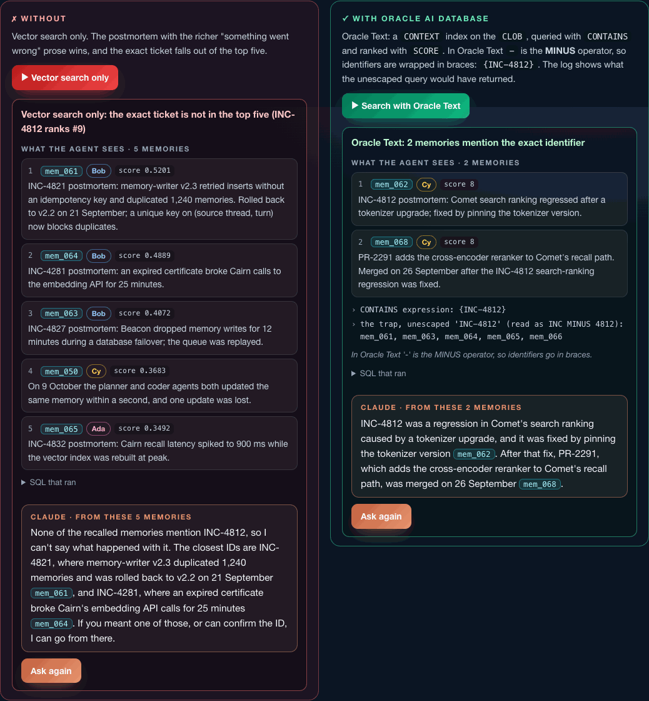
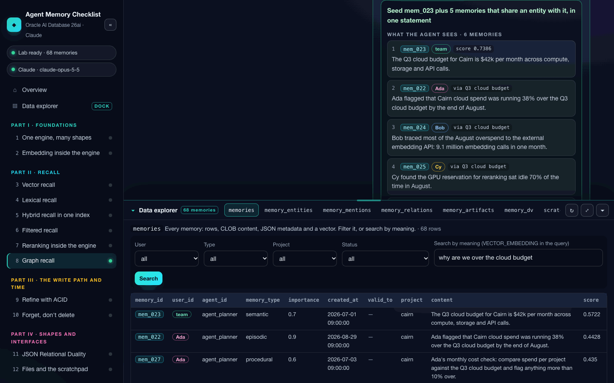

# Agent Memory Checklist · Appbook



An **appbook** is a working system you can click around in your browser, wrapped in the narrative that explains what you're looking at. This one is the interactive companion to the notebook [`agent_memory_checklist_oracle_claude.ipynb`](../../../notebooks/agent_memory/agent_memory_checklist_oracle_claude.ipynb): the same agent memory checklist, the same 68-memory dataset and the same SQL, one section per checklist item.

Every section has two sides, and both run live against Oracle AI Database 26ai:

- **Without**: the way it goes wrong when the capability is missing, from vector search that can't find an exact ticket to a store that leaks other users' memories.
- **With**: the same job done inside Oracle AI Database.

On either side, **Ask Claude** sends the question with exactly the memories that side returned. Same model, same instructions, and the answer changes with nothing but the context the database handed it.

It's a **FastAPI backend and a dependency-free JavaScript single-page app** (no build step, no `npm`). Embedding, keyword and hybrid search, reranking, graph traversal, transactions, history, documents, files, access control and audit all run inside the database. Claude is the only call that leaves your machine, plus §2's optional Hugging Face comparison.

---

## What you get

| Part | §   | Section                     | Without                                                               | With                                                                                                                        |
| ---- | --- | --------------------------- | --------------------------------------------------------------------- | --------------------------------------------------------------------------------------------------------------------------- |
| I    | 1   | One engine, many shapes     | four stores, four writes, no shared rollback                          | rows, `CLOB`, `JSON` and `VECTOR` in one table, one rollback                                                                |
| I    | 2   | Embedding inside the engine | the same model over the network (Hugging Face Inference)              | `VECTOR_EMBEDDING` in the database, with the speed-up and the cosine between both vectors                                   |
| II   | 3   | Vector recall               | keyword search misses a question that shares no words with the answer | search by meaning: HNSW index, `FETCH APPROX FIRST 5`                                                                       |
| II   | 4   | Lexical recall              | vector search can't find INC-4812                                     | Oracle Text `CONTAINS` with escaped identifiers                                                                             |
| II   | 5   | Hybrid recall               | two queries and a fusion function in Python                           | one hybrid vector index, `DBMS_HYBRID_VECTOR.SEARCH`, RRF or RSF                                                            |
| II   | 6   | Filtered recall             | post-filter empties a small tenant's context                          | the predicate inside the search, plus the optimiser's plan                                                                  |
| II   | 7   | Reranking                   | the fused order as it comes                                           | an ONNX cross-encoder scored with `PREDICTION`                                                                              |
| II   | 8   | Graph recall                | the vector seed alone                                                 | a SQL property graph and `GRAPH_TABLE`                                                                                      |
| III  | 9   | Refine with ACID            | autocommit leaves two contradictory facts                             | insert, close and link in one transaction                                                                                   |
| III  | 10  | Forget, don't delete        | only what the row says now                                            | `AS OF SCN` and `VERSIONS BETWEEN`                                                                                          |
| IV   | 11  | JSON Relational Duality     | a sync job and a lost update                                          | one copy as rows and documents; a stale ETag is refused                                                                     |
| IV   | 12  | Files and the scratchpad    | a URL the database never sees                                         | `CLOB`/`BLOB` artifacts with a foreign key, and a **DBFS** scratchpad Claude computes in, then promotes to long-term memory |
| V    | 13  | Identity-bound access       | a forgotten `WHERE user_id` leaks everyone                            | Deep Data Security: end users, a data role and a data grant                                                                 |
| V    | 14  | Audit                       | an application log with a gap                                         | Unified Auditing with the person, the agent and the request on every row                                                    |
| VI   | 15  | The agent                   | Claude with no memory                                                 | Claude with `recall_memories`, `remember` and `correct_memory`, running as the end user                                     |

Plus:

- **Data explorer**, docked at the bottom of every page: every table, view and file the sections use, read live. Collapsed, it's a bar of table tabs; open it and drag its top edge to make it as tall as you like, or maximise it. While it's open, each run refreshes it, so you watch the database change: run §9 and `mem_007_v2` appears. It covers `memories` (filter by user, type, project and status, or search by meaning), entities, mentions, links, artifacts, the duality view's documents, the DBFS scratchpad, the audit trail and the data grants. Click any memory ID, anywhere in the app, to open its JSON, its vector, its entities, links, artifacts and nearest neighbours.
- **Scorecard**: which items are proved on your database, with the evidence, and a button that runs every section in turn.
- **A collapsible sidebar**: `«` (or the `[` key) folds it into a rail of section numbers with their proved dots, and gives the page and the dock the extra width.



---

## Prerequisites

1. **Oracle AI Database 26ai, release 23.26.2 or later** (Deep Data Security needs it). The Free container is the quickest route, and a dedicated one keeps the lab clear of anything else you run:

   ```bash
   docker run -d --name agent-memory-checklist -p 127.0.0.1:1521:1521 \
     -e ORACLE_PWD=<choose-a-password> container-registry.oracle.com/database/free:latest

   # Once: give HNSW vector indexes some memory, then restart (without it the app uses an IVF index)
   docker exec -i agent-memory-checklist sqlplus -s / as sysdba <<< "ALTER SYSTEM SET vector_memory_size = 512M SCOPE = SPFILE;"
   docker restart agent-memory-checklist
   ```

2. **Python 3.11 or later.**
3. **An Anthropic API key** for the Claude buttons. Without one, every database run still works and the Claude buttons are disabled.
4. _Optional:_ a **Hugging Face token** (`HF_TOKEN`, or `hf auth login`) with Inference Providers access, for the network side of §2.

The appbook creates everything else itself: its own schema, `MEMORY_APPBOOK`, separate from the notebook's `MEMORY_LAB` so the two never step on each other; the end users `user_ada`, `user_bob` and `user_cy`; the two ONNX models; and every table, index, graph, view, grant, audit policy and the DBFS file system.

## Run it

From this folder:

```bash
python3 -m venv .venv
source .venv/bin/activate          # Windows: .venv\Scripts\Activate.ps1
pip install -r requirements.txt
cp .env.example .env               # then set ORACLE_DSN, ORACLE_CONTAINER and ANTHROPIC_API_KEY
python server.py --port 8890       # or ./run.sh
```

Open **http://127.0.0.1:8890**. On the first start the server creates the schema (through `docker exec` on `ORACLE_CONTAINER`, or as SYSDBA with `ORACLE_ADMIN_PASSWORD`), loads the models and builds the lab. The overview page shows the build log as it goes, which takes a minute or two (longer if the embedding model has to download). **Rebuild the lab** on the overview page puts every story back at its starting point.

The server binds to localhost and checks the origin of every write. Keys stay on the server: they're never sent to the browser, and error messages are scrubbed before they're shown.

---

## How it works

```text
server.py      FastAPI routes: status, the lab build, section runs, Ask Claude, the data explorer
lab.py         Configuration, the one-time admin setup, building the lab, query helpers
sections.py    The fifteen sections: one without and one with run each, same result shape
claude.py      Answers from recalled memories, and the tool runner for §12 and §15
corpus.py      The dataset: the notebook's 68 memories, 13 entities and 6 links
static/        index.html, app.js (the single-page app), content.js (the teaching copy), style.css, img/
```

Two design rules are worth knowing, because they're the difference between this running on a laptop and falling over:

- **The models live in one session.** `VECTOR_EMBEDDING` and `PREDICTION` load their ONNX model into the memory of the session that calls them, and Oracle AI Database Free has 2 GB of PGA for everything. So only the owner session runs models. End users, the second agent in §11 and the autocommit session in §9 get vectors **bound in** as parameters; they never call a model.
- **The hybrid index is synced on demand.** By default a hybrid vector index keeps itself current with a background job that wakes every few seconds and embeds new rows, which loads the model into yet another process. Here it's created with `SYNC (MANUAL)`, and the owner session calls `CTX_DDL.SYNC_INDEX` before any keyword or hybrid query.

Runs that change data (§9's correction, §11's document, §12's promotion, §15's memories) reset what they need first, so you can run any side as often as you like. **Rebuild the lab** resets everything.

## Scope and limits

This is a single-process local learning app: one owner session, used by one request at a time. The "without" sides of §1, §11, §12 and §14 are clearly labelled simulations (in-process dictionaries standing in for other products); every "with" side is a real database operation. End users log on with local passwords; in production the identity would arrive as an OAuth token from OCI IAM or Microsoft Entra ID, the memory service would write through a narrower account than the table owner, and audit administration would belong to a security officer.
