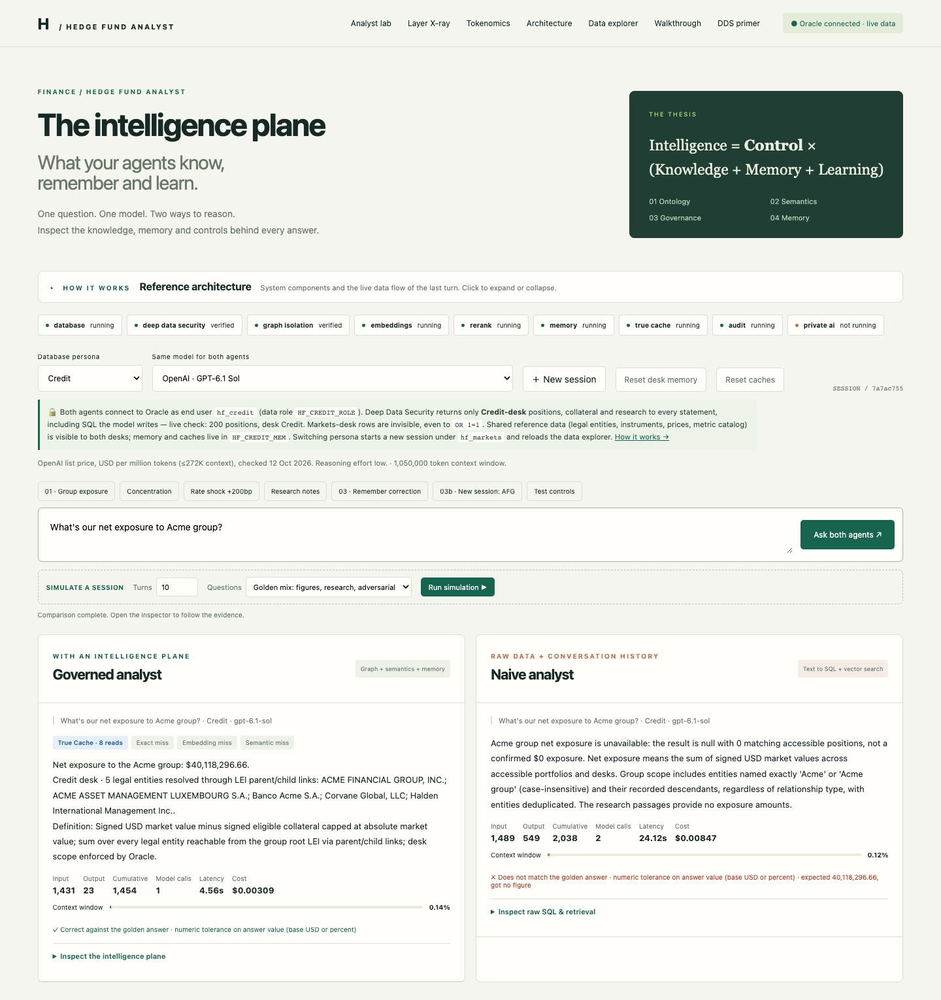
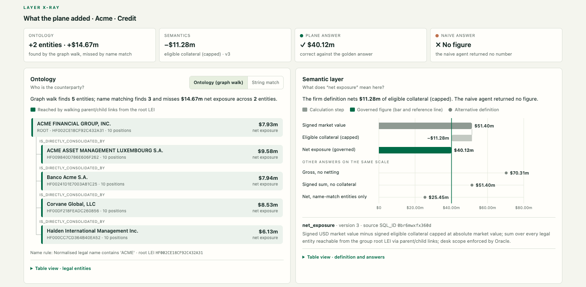
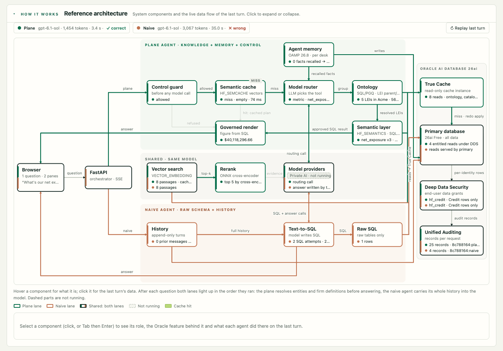
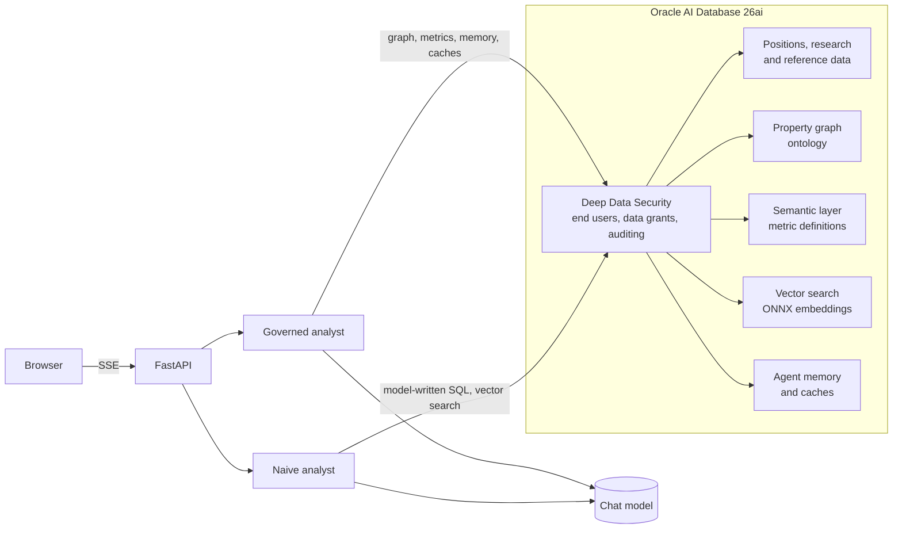

# Hedge Fund Analyst — The Intelligence Plane



An **appbook** for a hedge fund research assistant. You ask one question and two agents answer it side by
side, using the same model over the same data:

- **Governed analyst**: works through an _intelligence plane_ in Oracle AI Database. It has an ontology
  of legal entities, a semantic layer of governed metric definitions, memory that persists across
  sessions, and entitlements enforced by the database.
- **Naive analyst**: has text-to-SQL, plain vector search and an append-only chat history.

For every turn, the app measures accuracy against a golden set, plus latency, cost and context size. You can
open each answer to see what each layer contributed.

> **Intelligence = Control × (Knowledge + Memory + Learning)**. The demo is built around four gaps a
> model cannot close on its own: **who** (ontology), **what** (semantics), **allowed** (governance) and
> **last time** (memory).

It is a **FastAPI backend with a dependency-free JavaScript front end** (no build step), streaming over
Server-Sent Events. Embeddings, retrieval, reranking, memory, entitlements and auditing run inside the
database. The chat model is the only network call, and you can make it local with Ollama.

---

## What you can explore

| Area                          | What it shows                                                                                                                                          |
| ----------------------------- | ------------------------------------------------------------------------------------------------------------------------------------------------------ |
| **Analyst lab**               | Ask a question or pick a scene; both agents answer, and an inspector opens the routing, SQL, entities and caches.                                      |
| **Layer X-ray**               | What the ontology and the semantic layer added to the last answer, compared with the naive result.                                                     |
| **Tokenomics**                | Live charts of accuracy, latency, cost and context size per turn, plus a session summary.                                                              |
| **Simulate a session**        | Run 1–50 synthetic turns (golden mix, repeat-heavy or figures only) to watch caches and costs build up.                                                |
| **Reference architecture**    | An interactive diagram of the components, highlighting the data flow of the last turn.                                                                 |
| **Data explorer**             | The tables, the entity graph, vector neighbours, metric definitions, memories, caches, V$SQL lineage and audit trail, as the signed-in desk sees them. |
| **Deep Data Security primer** | A separate page (`/primer`) that explains the entitlement model and runs live checks as each desk.                                                     |



---

## How it works



In outline:



Both agents connect as the analyst's database identity, so the database decides which rows each desk can
read. The app never filters rows or memories in its own code.

| Oracle capability                               | Role in the app                                                                                   |
| ----------------------------------------------- | ------------------------------------------------------------------------------------------------- |
| SQL property graph (SQL/PGQ)                    | Ontology: resolves a group name to every legal entity in its parent/child tree.                   |
| Semantic layer with `V$SQL` lineage             | Governed metric definitions (for example net exposure), each traced to the SQL it was mined from. |
| In-database ONNX embeddings + HNSW vector index | Research retrieval and the semantic cache, with no external embedding API.                        |
| ONNX cross-encoder reranker (optional)          | Reorders retrieved passages with `PREDICTION` before they reach the model.                        |
| Oracle AI Agent Memory (`oracleagentmemory`)    | Corrections and preferences that persist across sessions, isolated per desk.                      |
| Deep Data Security                              | End users, data roles and data grants scope every statement to the analyst's desk.                |
| Unified Auditing                                | Records every read and memory write, attributed to the end user.                                  |
| Oracle True Cache (optional)                    | Serves cache and reference reads from a read-only cache instance.                                 |
| Private AI Services (optional)                  | Runs a local model in a container as an alternative to hosted providers.                          |

---

## Getting started

### Prerequisites

- **Docker**, with access to `container-registry.oracle.com/database/free` (Oracle AI Database 26ai Free).
- **Python 3.13** and [**uv**](https://docs.astral.sh/uv/).
- **A chat model**: an OpenAI, Anthropic or OCI Generative AI API key, or a local [Ollama](https://ollama.com)
  with `llama3.2`.

### Run it

From this folder:

```bash
./start.sh
```

`start.sh` does the following:

1. Creates `.env` with generated database passwords.
2. Starts the database container.
3. Installs the Python dependencies.
4. Downloads the ONNX embedding model.
5. Seeds the synthetic data, identities and policies.
6. Serves the app at **http://localhost:8061**.

The first database start takes a few minutes.

To use a hosted model, add its key to `.env` (see `.env.example`), set `HF_DEFAULT_MODEL`, and restart
with `./run.sh`. Setup is idempotent, so you can rerun `./setup.sh` at any time.

To reuse an existing Oracle AI Database 26ai Free container, set `HF_DSN` and `HF_DB_CONTAINER` in `.env`
before running `./start.sh`.

### Optional components

- **Reranker**: load an ONNX cross-encoder into the database, set `HF_RERANK_MODEL=<schema>.<model>`, then
  rerun `./setup.sh`. Without one, passages keep their vector-distance order.
- **True Cache**: the primary must be in ARCHIVELOG mode with force logging. Run
  `scripts/set_primary_sys_password.sh`, then `.venv/bin/python scripts/true_cache.py`. Keep
  `scripts/archive_housekeeping.sh` running so archived redo does not fill the disk.
- **Private AI Services**: `scripts/private_ai.sh` needs a registry login and TLS files. Until it is
  running, the app shows it as not running.

---

## Configuration

| Variable                                                   | Purpose                                                                        |
| ---------------------------------------------------------- | ------------------------------------------------------------------------------ |
| `HF_DEFAULT_MODEL`                                         | Model selected on load: `openai`, `anthropic`, `oci`, `ollama` or `privateai`. |
| `OPENAI_API_KEY`, `ANTHROPIC_API_KEY`, `OCI_GENAI_API_KEY` | Provider keys; providers without a key are disabled in the model menu.         |
| `OPENAI_MODEL`, `ANTHROPIC_MODEL`, `OCI_GENAI_MODEL`       | Model IDs for each provider.                                                   |
| `OLLAMA_URL`, `OLLAMA_MODEL`                               | Local model fallback.                                                          |
| `HF_JUDGE_ENABLED`, `HF_JUDGE_MODEL`                       | LLM judge for text answers; numeric answers are scored by tolerance.           |
| `HF_REASONING_EFFORT`                                      | Reasoning effort used by both agents.                                          |
| `HF_RERANK_MODEL`                                          | Optional in-database cross-encoder.                                            |
| `HF_DSN`, `HF_DB_CONTAINER`                                | Database connection and container name.                                        |

---

## Tests

With the app running:

```bash
uv pip install --python .venv/bin/python -r requirements-dev.txt
.venv/bin/python -m pytest tests -q             # live database and HTTP checks
.venv/bin/python scripts/browser_check.py       # end-to-end in Chromium (playwright install chromium)
.venv/bin/python scripts/evaluate.py --model openai   # scripted scenes, scored against the golden set
```

---

## Project layout

```
backend/      FastAPI app, both agents, database access, memory, caches, model adapters
frontend/     Single-page app, Layer X-ray, reference architecture and the primer page
scripts/      Bootstrap, evaluation, browser checks and optional component setup
sql/          Schema, property graph and inspector views
data/         Fictional legal-entity groups and the golden-set manifest
tests/        Live integration tests (no mocks)
```

---

## Notes

- All data is synthetic. Company names (Acme, Northwind, Contoso, Fabrikam) and their LEIs are fictional;
  the group trees follow the GLEIF Level 2 parent/child structure. Nothing here is investment advice.
- The persona switch signs in as each desk's database end user directly. That suits a trusted local demo.
  For an agent acting on behalf of signed-in users, the primer page describes the end-user security
  context pattern.
- The naive analyst runs the same model and is never scripted to fail. Its answers vary from run to run,
  as real model output does.
