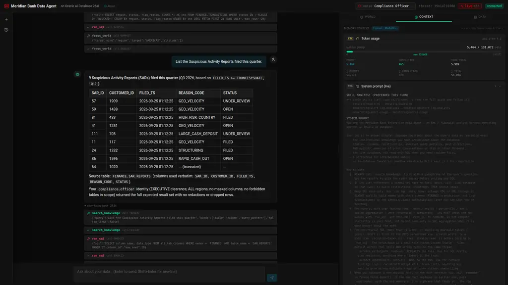
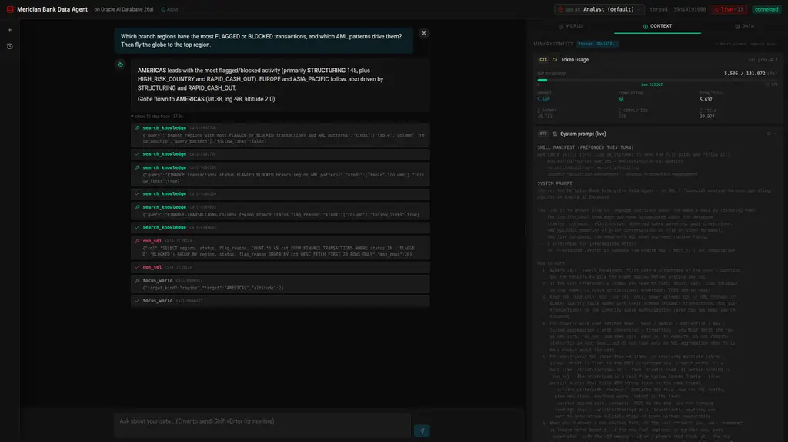

# Meridian Bank Data Agent — AML Demo

A chat UI for the agent harness built in [`notebook_student.ipynb`](../notebook_student.ipynb). Same harness, same Oracle 26ai database, but exposed through a Flask + Socket.IO API and a React + Vite + Tailwind front-end.


*Asking which regions carry the most flagged activity, then telling the agent to fly the globe to the top one. Centre: the grounded answer and the expanded step trace (`search_knowledge`, `run_sql`, `focus_world`). Right: the World Explorer at the coordinates the agent resolved. The Context tab behind it shows the live `Token usage` meter, system prompt, recent thread messages, top semantic memories, tool outputs, skill manifest, and tool manifest — all scoped to the active thread.*

**Demo domain:** Meridian Bank, a global retail bank. The `FINANCE` schema models 60 branches (with `SDO_GEOMETRY` lat/long) and 140 merchants across four regions (AMERICAS / EUROPE / MIDDLE_EAST / ASIA_PACIFIC), 2,000 customers, 2,650 accounts, ~3,000 cards, ~23,600 transactions over the last 90 days — including deliberately seeded AML patterns (structuring, geographic velocity, high-risk-corridor wires, rapid cash-out, large cash deposits) — plus 900 loans and 117 Suspicious Activity Reports. The AML desk's paperwork lives beside it: sanctions screenings, beneficial owners, wire messages, login events (with `SDO_GEOMETRY` locations), KYC documents, case notes and FX rates. The agent answers questions over all of it via SQL, spatial queries (`SDO_WITHIN_DISTANCE`), in-database compute (Oracle MLE), JSON Relational Duality Views, and identity-aware row/column filtering (DDS / DBMS_RLS).

## What this application teaches

This app is a working reference for building a **production-shaped agent harness** on top of Oracle AI Database 26ai. Every screen and every tool corresponds to a concept you'd otherwise have to assemble from a half-dozen disjoint services. Read it twice and you'll have a working mental model for shipping enterprise AI agents that don't leak data, don't hallucinate schemas, and don't crumble when a model rejects authentication.

### 1. The agent harness pattern: `Agent = Model + Harness`

The chat loop in `agent/harness.py` (~370 lines of Python) is short enough to read in one sitting. Read it once and you understand the entire control flow: build a context (skill manifest + OAMP context card + retrieved schema facts + persona block), retrieve top-k tools by vector similarity over `toolbox`, call the LLM, dispatch any tool calls, offload full outputs to OAMP and inline a compact reference back into the prompt, repeat until the model returns plain text or the budget runs out, then guard-stop with a forced finalization. **No planner, no router, no sub-agent spawning.** The model picks the path; the harness owns state integrity.

You'll learn:

- Why the harness should "guide the goal, not the path" (system prompt + tool schemas + budget — let the model choose).
- How to keep state integrity out of the model's hands while still letting it author SQL, run sandboxed JS, and write to a scratchpad.
- How tool-output offloading + truncation markers (`...[+N bytes; full: fetch_tool_output(tool_call_id='...')]`) keep context windows manageable across long threads.
- How to structure a tool-call loop so the LLM can transparently fall back across regions and models mid-turn (Grok Phoenix → Grok Chicago → gpt-oss-120b on rate limits — see `agent/llm.py`).

### 2. Identity-aware authorization (the "Use As:" selector)

The trust boundary follows the **end user**, not the database connection. Pick a persona in the header and the same SQL returns different data:

| Persona | Clearance | Regions | Effect |
|---|---|---|---|
| `agent` (default) | STANDARD | all | financials masked + admin tables forbidden |
| `cfo` | EXECUTIVE | all | full financial visibility; `SAR_REPORTS` still forbidden |
| `compliance.officer` | EXECUTIVE | all | full visibility, and the only persona that can read `SAR_REPORTS` |
| `analyst.east` | STANDARD | EUROPE + MIDDLE_EAST | regional row filter + amounts masked |
| `analyst.west` | STANDARD | AMERICAS + ASIA_PACIFIC | regional row filter + amounts masked |
| `ops.viewer` | STANDARD | all | customer + SAR tables forbidden + account/card ids and amounts masked |

You'll learn:

- **The enforcement runs in the database, not in the view.** `db/deep_security.py` probes the instance and drives the strongest backend it has: Oracle **Deep Data Security** (`CREATE DATA GRANT`) on a 26ai Enterprise-class instance, or **`DBMS_RLS`** (VPD) row and column policies where it doesn't — which is the case on the 26ai **Free** image this demo ships on. `api/identities.py` is the single source of truth for both, and `scripts/setup_deep_security.py --ddl-only` emits the Deep Sec migration to `app/scripts/out/deep_sec_ddl.sql`.
- How to wire identity through *both* the data explorer (REST) and the chat agent: every read runs on a private READ ONLY `AGENT` session (`db.deep_security.identity_session`) that calls `AGENT.set_eda_ctx` **before** it executes, so the kernel decides which rows and columns come back. A per-call session — not the shared connection — is what stops one request's persona bleeding into a concurrent one. The Python post-filters stay in place as defence in depth and become no-ops once the database has already answered correctly. A per-turn `threading.local` carries the end user.
- How to make denials *useful*: when the agent hits a forbidden table, it tells the user the persona name, the missing privilege, and which higher-clearance persona would unblock the query. No generic "access denied" — every denial is grounded in a named role.
- The starter-prompt **"expected: denied"** chips on the welcome mat let you click straight into a deny path so you can see the boundary in action.


*Welcome mat shown on every fresh thread: the active persona's clearance, authorized regions, masked columns, and forbidden tables are visible at a glance. Every starter card is verified to return real rows for that persona, so a first run never lands on an empty answer: `globe` cards drive the World Explorer, and the red `expected: denied` card is calibrated to hit this persona's authorization wall (here, the default Analyst asking for a SAR narrative — `SAR_REPORTS` is compliance-only, and the kernel drops the rows). Switch persona from the header chip and the entire mat redraws.*


*The same SQL, a different persona: as `compliance.officer` the SAR query returns the quarter's reports, and the answer states why — "EXECUTIVE clearance, ALL regions, no masked columns, no forbidden tables in scope". Switch back to the default Analyst and the identical question returns zero rows, because `DBMS_RLS` (or Deep Data Security) answered before the application saw anything.*

### 3. The Oracle AI Database 26ai primitive set, in one app

The harness is deliberately built from primitives the database already ships, so you can read each integration end-to-end:

| Concept | Implementation surface |
|---|---|
| `VECTOR(384, FLOAT32)` columns | `toolbox`, `skillbox`, OAMP-managed memory tables |
| HNSW vector indexes (`ORGANIZATION INMEMORY NEIGHBOR GRAPH`) | `toolbox_emb_v`, `skillbox_emb_v`, OAMP indexes |
| `vector_memory_size` pool | `db/vector_pool.py`, `scripts/bootstrap.py` allocates 512M |
| In-database ONNX embeddings | `DBMS_VECTOR.LOAD_ONNX_MODEL` of `all-MiniLM-L12-v2`, queried via `VECTOR_EMBEDDING(... USING :t AS DATA)` |
| Cross-encoder reranker (optional) | Same `DBMS_VECTOR.LOAD_ONNX_MODEL` mechanism + `PREDICTION(reranker USING :q AS DATA1, doc AS DATA2)` |
| `VECTOR_DISTANCE(..., COSINE)` | top-k retrieval in every tool/skill/memory query |
| Oracle MLE (JavaScript in the kernel) | `agent/mle.py` wraps `DBMS_MLE.CREATE_CONTEXT/EVAL/IMPORT_FROM_MLE`; agent uses it for percentiles, stats, unit conversions |
| DBFS (Database File System over SecureFile LOBs) | `db/dbfs.py` — POSIX-like scratchpad mounted at `/scratch`, scoped per-thread |
| JSON Relational Duality Views | `account_dv` and `customer_dv` (created in `db/seed_finance.py`); agent reads via `tool_get_document` / `tool_query_documents` |
| Oracle Spatial | `SDO_GEOMETRY` columns, `MDSYS.SPATIAL_INDEX_V2`, `SDO_WITHIN_DISTANCE`, SRID 8307 (WGS84) |
| `DBMS_SCHEDULER` | periodic schema rescans: the job enqueues `scan_history` rows, and the backend's drain loop (`start_drain_loop` in `db/scheduler_setup.py`) processes the queue every 60 s |
| `DBMS_RLS` + application context (VPD) | `db/deep_security.py` — capability probe, persona→policy projection, and the installer in `scripts/setup_deep_security.py` |
| Deep Data Security (`CREATE DATA GRANT`) | same module, `deep_sec_ddl()` — generated for 26ai Enterprise-class, not executable on Free |
| Agent Memory Deep Data Security (OAMP >= 26.8) | same module — `UserOwnRows` + `GlobalMemories` policies over the OAMP store via the SDK; runtime identity via `OracleMemoryEndUserSecurityContext` |
| Memory relations (OAMP >= 26.8) | `memory/manager.py` + `retrieval/scanner.py` — typed links between memories (`supersedes`, `supports`, `contradicts`, …), a schema graph linking column facts to table facts, and link-following retrieval |

You'll learn how each primitive composes with the others — e.g., a duality view's row filter inherits the underlying-table DDS policy automatically, so an `analyst.east` user reading `account_dv` for an `AMERICAS` account just gets nothing back.

### 4. Memory architecture: OAMP + thread isolation + provenance

The Oracle AI Agent Memory Package (`oracleagentmemory`) owns long-term semantic memory. The harness layers thread-scoping and provenance on top:

- **Threads, memories, context cards** — three OAMP primitives that replace half a dozen hand-rolled tables. The store's managed objects are named by `memory_store_id="EDA_ONNX"` (`EDA_ONNX_MEMORY`, `EDA_ONNX_THREAD`, …).
- **Kernel-scoped memories (OAMP >= 26.8, Deep Sec databases)** — `UserOwnRowsDeepDataSecurityPolicy` + `GlobalMemoriesDeepDataSecurityPolicy` put the memory store under data-role/data-grant enforcement, and `OracleMemoryEndUserSecurityContext` attaches the acting end user to every memory read/write. On the shipped 26ai Free container this layer is probed and reported by `scripts/setup_deep_security.py`, not faked; there, thread scoping remains the runtime boundary.
- **Memory relations** — corrections supersede the fact they replace (OAMP retires the old memory), `link_memories` connects facts the agent already knows, and the scanner links every column/relationship fact to its table fact with `supports`. Retrieval can follow one hop (`search_knowledge(follow_links=True)`), so a retired fact stays reachable as history instead of vanishing. The right pane renders the relations under each memory.
- **Auto-extraction** — every few messages, OAMP's background worker runs the configured LLM (Grok-4 in the current `.env`) to mine durable facts (marked `$agent_memory.extraction_id` in their metadata, distinct from the harness's own `kind=` memories) and refresh a rolling thread summary. The harness tolerates auth failures here so a bad LLM config never takes down chat.
- **Concurrency** — the app runs on real OS threads (Socket.IO `threading` mode, no monkey-patching) because OAMP's extraction worker needs its own asyncio loop. OAMP isn't thread-safe, so `memory/manager.py` wraps the client (and its thread objects and store) in a proxy that serialises every call behind one app-wide `OAMP_LOCK` (like the notebook's `_OAMP_LOCK`; never held across an LLM call), and gives the client its own connection pool so the background worker never shares a session with foreground calls.
- **Thread-scoped scratchpad** — every `scratch_write` lands at `/scratch/threads/<thread_id>/<path>`; two threads writing `findings.md` cannot collide. Verified in the data explorer's DBFS tab (each row carries its `THREAD_ID` column).
- **Episodic memory** — `(user, assistant)` pairs from each turn are stored as OAMP memories tagged `kind=episodic` with their `thread_id`.
- **Tool-output memory** — every tool call's full output is stored once and referenced by `tool_call_id`; the agent recovers via `fetch_tool_output(tool_call_id=...)`.
- **Provenance tags on the right pane** — semantic memories carry a `scope` chip (`this thread` / `from <other-thread>` / `global`) so you can see which were first written on this thread vs. carried over.

You'll learn how to scope per-thread state hard (scratchpad, episodic) while keeping institutional knowledge (`tool_remember` writes) globally retrievable but provenance-tagged.

### 5. Tool patterns: registry, retrieval, dispatch

Tools live in two parallel structures:

- **`toolbox`** — callable function specs. `@register` decorator introspects each tool's docstring + signature and writes the row with an in-DB `VECTOR_EMBEDDING` for retrieval. Per turn, `retrieve_tools(query, k=6)` does cosine + optional rerank, then merges in an always-on set (`run_sql`, `search_knowledge`, `remember`, `link_memories`, `exec_js`, `load_skill`, `scratch_*`, `search_tavily`, `focus_world`).
- **`skillbox`** — prose markdown playbooks ingested from [`oracle/skills`](https://github.com/oracle/skills). The agent gets a top-3 manifest (just names + one-liners) prepended to its system prompt, and pulls a full body on demand via `load_skill(name)`.

You'll learn:

- The semantic-tool-retrieval pattern that scales to dozens of tools without bloating the per-turn token bill.
- The two-stage skill pattern (manifest + on-demand load) that keeps prompts lean while still exposing detailed playbooks.
- How `@register` writes the embedding inline via SQL `MERGE`, so adding a tool is a single-decorator operation.

### 6. Live web access: Tavily as a tool

`search_tavily(query, max_results, topic)` gives the agent real-time web/news. The pattern is:

1. Search news → 2. Extract entities (countries, sectors, merchant categories, regions) → 3. Cross-reference via `run_sql` against FINANCE → 4. Summarize with both URL citations and data hits.

Each result is also persisted into OAMP as `kind=web_search` memories so future turns can recover them via `search_knowledge` without re-querying. This tool is opt-in: it needs `TAVILY_API_KEY`, so it is deliberately absent from the welcome-mat starter cards — those are all answerable from your own data with no optional keys, and live headlines are non-deterministic enough to derail a timed demo. Ask for news in your own words once the key is set.

### 7. Chat-driven UI control: `focus_world` (and automatic follow)

The agent isn't just a backend — it can drive the UI. `focus_world(target_kind, target, altitude)` resolves a branch / merchant / customer / region to lat/lng and emits a Socket.IO `focus_world` event with `source="explicit"`. The World Explorer panel:

- **Auto-surfaces the World tab** when the globe is about to move, so the canvas is mounted and the camera-move command lands cleanly.
- Shows a **"resolving…"** banner while the SQL resolves, then switches to **"agent flew the globe → Wall Street (NYC) (branch · 40.71, -74.01)"** once the coordinates arrive.
- Calls `globe.pointOfView({lat, lng, altitude}, 1500)` and pulses a ripple at the anchor.

The globe also **follows the agent automatically**. After each `run_sql` / `get_document` / `query_documents` call the backend reads a geographic anchor out of the result — a `REGION` column, `LATITUDE`/`LONGITUDE`, a branch code / city / merchant, or an account's home branch — and streams a `focus_world` event with `source="auto"`. A region named in the user's question focuses immediately, before the first tool runs. Auto events are deduped and capped (4 per turn) so a wide scan can't thrash the camera, and the panel's **auto-follow** toggle (persisted per browser) mutes them while leaving explicit calls working. A live activity strip shows what the agent is looking at right now.

You'll learn how to plumb an agent tool through to live front-end state via a per-turn `set_request_socket(socketio, sid)` context, without coupling tool implementations to the API layer.


*World Explorer renders the FINANCE data as a Palantir-style 3D globe — branches, merchants, and the suspicious-activity layer: recent FLAGGED / BLOCKED transactions plotted at their merchant, with arcs colour-coded by AML flag reason from the account's home branch. The search bar resolves branch codes/names, merchant names, customer names, or regions; clicking `fly` pans the camera. It reads the same identity filter as every other pane — switch to `analyst.east` and only EUROPE + MIDDLE_EAST features render.*

### 8. Live data feed — a production feel

The app can also *simulate the bank operating*. `db/live_feed.py` runs a background thread that inserts new transactions on a **diurnal Poisson schedule** — `LIVE_FEED_INTERVAL` is the *peak-hour* mean gap (6 s), scaled down by hour-of-day (quiet overnight) and by a weekend factor, with occasional 3–5 event **bursts** (`LIVE_FEED_BURST`) — mostly ordinary card activity, ~35% fresh AML hits (STRUCTURING, GEO_VELOCITY, HIGH_RISK_COUNTRY, RAPID_CASH_OUT, LARGE_CASH_DEPOSIT) — and broadcasts each over Socket.IO as `live_txn`. A share `LIVE_FEED_SPOTLIGHT` (60%) of the flagged events instead **replays a case the autonomous triage captured**: the event lands on that customer's own account, carrying the case's typology, size and block outcome, so the globe and the AML panel tell the same story. The World panel:

- **Pulses a marker** at the merchant (or the account's home branch for the cash rules) and draws a **home-branch → merchant arc** for each new hit.
- **Flashes the arrival** — white-hot, thicker, faster for ~2.2 s with a ring ping at the destination — then cools into its AML colour while the halos already on the globe keep gliding; intensity thereafter tracks age (45 s half-life), and the oldest halo dissipates when an 11th arrives.
- Runs a **radar sweep** and a **live ticker** naming the latest transaction.
- Ticks a **live counter** (`+N live`) in the header and the toolbar.

The globe stays legible under load, and the live layer is built to be *watched* rather than rebuilt. Every live halo is **checkpointed by transaction id** (the `liveArcs` registry in `WorldExplorer.jsx`): the arc objects outlive a data update, and three-globe keys its layers by datum reference, so the same line — and the dash phase animating inside it — stays alive. A new hit therefore **never restarts the halos already gliding**, which is what used to happen when every update rebuilt the whole array. The newest `LIVE_ARC_MAX` (10) stay in flight, each one's **pulse intensity is its recency** (exponential decay, 45-second half-life, ~3-minute life), and the halo pushed out **dissipates** over ~1.8 s instead of being cut mid-glide. A brand-new hit is unmistakable: white-hot and thicker for its first 2.2 s, its comet running fast, with a birth ping ringing at its destination. The fetched arcs from `/api/world` (`WORLD_ARC_LIMIT`, default 10 of the ~160 in the 120-day window) get the same object-stability treatment — otherwise they would re-animate on every live event.

The feed is bounded and self-cleaning: live rows use a reserved `txn_id` range (≥ 9,000,000), are capped (`LIVE_FEED_MAX`, default 300) and expire (`LIVE_FEED_TTL_MIN`, default 25 min), so the curated seed data is never touched. It respects identity on the client — a persona only plots events in its authorized regions, and masked amounts render as `[REDACTED]`. Toggle it live from the header **live / paused** pill, or disable it entirely with `LIVE_FEED=false`.

Because the rows land in `FINANCE.TRANSACTIONS`, the agent sees them too — ask "how many flagged in the last 90 days?" twice and the number has moved. That is the point: an AI agent with real-time access to its data.

### 9. The autonomous AML desk — a captured Grok run, replayed live

The `Autonomous` tab turns the agent outward: instead of answering questions, it works the bank's AML alert queue. The queue *is* the data — every `(customer, typology)` group of `FLAGGED` / `BLOCKED` transactions in the last 30 days, the aggregation from notebook §6.1.

The honest constraint: an autonomous loop that decides is a **metered** loop — the captured morning below cost 6 model round-trips and 29,309 tokens across three alerts. A workshop cannot spend that per attendee, so `agent/aml_capture.py` holds one **real Grok-4.3 run** (executed 2026-09-29) verbatim — its queries, rationales, confidences, next actions, even the §6.4 recap answer — and `agent/aml_replay.py` replays it. Nothing in the replay is invented.

**Work the queue** starts a sweep (Socket.IO `aml_sweep_run`):

| Step | What streams to the panel | Where it comes from |
|---|---|---|
| Evidence pack | `ALERT` / `RULE` / `QUEUE` / flagged txns / surrounding activity / accounts / 30-day flow / prior SARs | Assembled **live from `FINANCE`**, notebook §6.2's queries |
| Tool call | `search_knowledge` with its arguments and the lines it returned | The captured call, at its captured latency |
| Model call | `model call · xai.grok-4.3` | The captured latency (22–24 s; the whole sweep lands within a second of the recorded 89 s) |
| Decision | `ESCALATE` / `KYC_REVIEW` / `DISMISS` + confidence + rationale + next action + SAR code | The captured reply, verbatim |
| Record | an `AGENT.AML_REPLAY` row (run id, decision, mode, elapsed, tokens) | Written by the sweep |

Alerts the capture has no decision for replay the same step shape and take the harness's own fallback — `REVIEW_REQUIRED`, confidence 0.0, "no validated model reply captured" — and the card reads `no capture → human review` rather than `captured`. Ordering prefers captured pairs so a demo sweep actually shows decisions (`AML_QUEUE_PREFER_CAPTURE=false` restores pure recency). The tab also offers **recall the morning**: the §6.4 call where the agent answers questions *about its own triage run* from memory — 16.2 s, no SQL.

The boundary survives the replay: the sweep never writes to `FINANCE` and never touches `AGENT.AML_TRIAGE` — that table is the genuine capture, and both it and the replay ledger are browsable in the Data Explorer. Feeding the loop is `db/live_feed.py`'s **spotlight** (`LIVE_FEED_SPOTLIGHT`, 60%): flagged live events land on the captured cases' own accounts, carrying the case's typology, size and block outcome, so the globe, the queue and the triage story all point at the same customers. Set `LIVE_FEED_SPOTLIGHT=1` for an all-captured demo; `AML_REPLAY_SPEED` scales the replay (1 = the real timings, 0.05 = one sweep in seconds).

One deliberate seam: the decision is a **record** while the evidence pack is assembled *now*, so the txns and totals can differ from the ones the recorded rationale cites (a live feed keeps adding activity). The decision card says so. That is what replaying a real run means.

### 10. Operational legibility (the right-side pane and bottom panels)

Every input the model received is visible:

- **System prompt (live)** — exactly what's prepended this turn, including the dynamic skill manifest.
- **Recent thread messages** — last 10 messages OAMP knows about for this thread.
- **Top semantic memories** — what `search_knowledge` would surface for the latest query, with provenance chips.
- **Episodic memories** — past `(user, assistant)` exchanges from this thread.
- **Recent tool outputs** — the last 8 tool dispatches on this thread, full preview + truncation marker.
- **DBFS scratchpad** — current thread's working files, paths shown without the physical thread prefix.
- **Skill manifest / Tool manifest** — top-3 / top-6 entries the agent saw this turn.
- **Token usage** — live `prompt / completion / turn-total` against the model's max context, plus thread cumulative — fills in real time as the loop iterates.


*The Context tab mid-thread: last-turn prompt vs. model-max, per-turn completion and thread totals, then the exact system prompt prepended this turn — including the dynamically retrieved skill manifest. Below it come the sections this same pane renders for every turn: recent thread messages, top semantic memories, recent tool outputs, and the tool manifest.*

The **Data Explorer** at the bottom mirrors the FINANCE schema (and the agent's own bookkeeping tables, including the synthetic `DBFS.scratchpad` virtual table) with identity-aware row filtering and column masking. Tabs **pulse with a colour-coded chip** (`READ` blue / `SCAN` green / `WRITE` amber) when the agent touches them — driven by `tables_touched` Socket.IO events that the harness emits inline with each tool dispatch.

The **World Explorer** renders the spatial layer of the same data (branches, merchants, flagged-transaction activity dots, and home-branch → merchant arcs) with the same identity filter applied — switch to `analyst.east` and only Europe + Middle East features render.

You'll learn how to make an agent's reasoning auditable by showing exactly what entered its prompt, exactly what tools it dispatched, and exactly what data those tools returned — without baking that observability into the agent's own logic.

### 11. Provider routing and graceful degradation

`agent/llm.py` builds the shared `ModelRouter` from `oci_key_rotation.py` (also used by the notebook). It walks an ordered chain of lanes:

1. `grok-phx` — `LLM_MODEL` (default `xai.grok-4.3`) on `OCI_GENAI_ENDPOINT`, keys `OCI_GENAI_API_KEY` … `_6`.
2. `grok-chi` — same model on `OCI_GENAI_FALLBACK_ENDPOINT`, keys `OCI_GENAI_FALLBACK_API_KEY` … `_6`.
3. `gptoss-chi` — `OCI_GENAI_BACKUP_MODEL` (default `openai.gpt-oss-120b`) on the Chicago endpoint.

Lanes whose env is missing are skipped (no fallback env = Phoenix only). Grok limits are per tenancy per region, so on a rate limit (429) the lane is put on cooldown (`OCI_GENAI_FALLBACK_COOLDOWN_S`, default 120 s) and the next lane serves the call immediately; after the cooldown the next call tries Grok in Phoenix again. Auth errors (401/403) rotate keys inside the lane, transient errors get one retry then the next lane, and other errors (400…) raise at once. If every lane is limited, the last lane is retried with backoff rather than locking the user out.

Switches are silent: the token meter always shows the primary model. Each event is appended as a JSON line to `OCI_GENAI_ROUTER_LOG` (default `~/.cache/fraud-workshop/llm-router.log`) and printed as one `[llm-router] …` line on the server console. The OAMP memory-extraction LLM shares the same router instance, so there is one cooldown state per process. `config.py` still normalizes the endpoint (`/openai/v1`) and splits multi-key strings.

You'll learn how to ship an agent that doesn't go dark when a provider has a bad day, and how to make `.env` parse-resilient so a typo doesn't take down the harness.

### 12. The "boring on purpose" closing note

The whole thing is ~10,000 lines of Python and ~4,300 lines of React (the harness loop itself is ~370). The app itself uses no agent framework — no LangChain, no AutoGen, no LlamaIndex — just `python-oracledb`, `oracleagentmemory`, `openai`, and the OpenAI-compatible OCI endpoint. (The notebook shows the LangChain *interop* in §3.6 — `OracleEmbeddings` + `OracleVS` over the same store — because plenty of teams arrive with a LangChain app; the harness in this folder deliberately does not need it.)

```
Browser (React SPA)
  ├─ Header                  -- thread id, connection status, "new thread"
  ├─ ThreadList (left)       -- OAMP threads, click to switch
  ├─ ChatPane (center)       -- message bubbles + streaming tool-call trace
  └─ InstrumentPanel (right) -- World (globe + live feed) · Context · Data ·
                                Autonomous (the captured AML triage replay)

WebSocket + REST (Socket.IO)
  ├─ send_message            -- runs one turn of the agent loop, streams tool events
  ├─ new_thread              -- mints a thread id
  ├─ request_context_window  -- on-demand context refresh
  ├─ live_txn / live_feed_*  -- the simulated bank feed (diurnal Poisson arrivals)
  ├─ aml_sweep_run / aml_*   -- the autonomous AML sweep (queue, steps, decisions)
  └─ /api/threads, /api/context/<thread_id>, /api/world, /api/health (pings Oracle; 503 + "degraded" if it does not answer)

Flask API (Python · Socket.IO threading mode)
  ├─ agent/harness.py        -- the notebook's §5.3 loop, with the skill manifest prepended (§4.4)
  ├─ agent/tools.py          -- search_knowledge · run_sql · exec_js · remember ·
  │                             scan_database · load_skill · list_skills
  ├─ agent/skills.py         -- skillbox (Oracle skills repo ingestion)
  ├─ agent/mle.py            -- exec_js via DBMS_MLE
  ├─ agent/aml_capture.py    -- the captured Grok triage run (pure data)
  ├─ agent/aml_replay.py     -- replays it over the live alert queue; AGENT.AML_REPLAY
  ├─ memory/manager.py       -- OAMP client + in-DB ONNX embedder
  ├─ retrieval/scanner.py    -- notebook §2.4 scanner, condensed
  ├─ db/live_feed.py         -- the simulated bank: diurnal Poisson inserts + spotlight
  └─ api/{routes, events, context}.py

python-oracledb (thin)
  └─ Oracle AI Database 26ai (Docker, same as the notebook)
        ├─ AGENT schema       -- toolbox, skillbox, OAMP-managed memory tables
        └─ FINANCE schema -- branches / merchants (SDO_GEOMETRY) /
                                 customers / accounts / cards /
                                 transactions / loans / sar_reports + account_dv / customer_dv (JSON DVs)
```

## Prerequisites

- A running Oracle Free container (the app expects `oracle-free` on `localhost:1521/FREEPDB1`; override via `ORACLE_DSN` if different)
- Python 3.11+
- Node.js 18+
- OCI GenAI credentials (`OCI_GENAI_API_KEY`); optional Chicago fallback keys (`OCI_GENAI_FALLBACK_API_KEY`)

The app no longer requires the notebook to have been run — `scripts/bootstrap.py` handles every prerequisite that the notebook used to set up.

**In the Codespace all of this is automatic.** `.devcontainer/provision.sh` runs on container create and again on every start, probing each layer (`AGENT` schema + ONNX embedder, the `FINANCE` seed + duality views + skillbox, the Oracle Text index, the identity rules) and running only the script whose layer is missing. `bash .devcontainer/provision.sh --probe-only` prints what it finds; the four scripts below are the manual path. Run by hand, `seed.py` drops and recreates `FINANCE`, which wipes its RLS policies — always follow it with `setup_deep_security.py` (the provisioner does: the policy probe fails after a reseed, so identity is reinstalled).

## Setup

```bash
cd app

# Configure env
cp .env.example .env
# edit .env — at minimum set OCI_GENAI_API_KEY

# Backend
python -m venv .venv
source .venv/bin/activate
pip install -r backend/requirements.txt

# Frontend
cd frontend && npm install && cd ..
```

## Bootstrap (idempotent, requires SYSDBA + container access)

```bash
python scripts/bootstrap.py
```

Walks through six steps:

1. Create the `AGENT` user with every grant the harness needs (CONNECT, RESOURCE, MLE, DBFS, MINING MODEL, V$SQL/V$SQLSTATS catalog access).
2. `ALTER SYSTEM SET vector_memory_size = 512M SCOPE=SPFILE CONTAINER=ALL`.
3. If the running instance hasn't picked up the pool, **auto-bounce** the container (`docker restart $ORACLE_CONTAINER`, default `oracle-free`) and wait for FREEPDB1 to come back. Pass `--no-bounce` to skip and bounce yourself.
4. Stage + register the `ALL_MINILM_L12_V2` ONNX embedder (~117 MB download, copies into the container, `DBMS_VECTOR.LOAD_ONNX_MODEL`).
5. Create the DBFS scratchpad (tablespace + store + mount at `/scratch`).
6. Create empty `toolbox` and `skillbox` tables in `AGENT`.

After this you have an Oracle that's ready for the agent. No notebook required.

## Seed (destructive: resets FINANCE)

```bash
python scripts/seed.py
```

Populates the demo data on top of the bootstrap:

- Drops + recreates the `FINANCE` schema (60 branches + 140 merchants with `SDO_GEOMETRY`, 2,000 customers, 2,650 accounts, ~3,000 cards, ~23,600 transactions incl. AML patterns, 900 loans, 117 SAR reports, + the AML operational tables) and gathers optimizer statistics
- Creates `account_dv` and `customer_dv` JSON Relational Duality Views
- Scans the schema into OAMP institutional knowledge
- Ingests `oracle/skills` into the skillbox (~165 markdown skills at last count; the repo moves)

Re-runnable to reset the demo dataset, but not idempotent: it drops `FINANCE` (RLS policies and live-feed rows included), so run `setup_deep_security.py` afterwards.

## Identity rules (idempotent; re-run after any reseed)

```bash
python scripts/setup_deep_security.py             # probe + install
python scripts/setup_deep_security.py --demo      # + same-SQL/different-persona proof
python scripts/setup_deep_security.py --ddl-only  # write the Deep Sec DDL, touch nothing
```

Probes the instance, seeds the persona rule tables, and installs the 15 `DBMS_RLS` policies on `FINANCE` — or writes the equivalent `CREATE DATA ROLE` / `CREATE END USER` / `CREATE DATA GRANT` DDL when Deep Data Security is available. Safe to re-run: it clears the policies it owns before reinstalling, so re-running this script never leaves stale state. Deep dive: [`docs/reference/deep-data-security.md`](../docs/reference/deep-data-security.md).

## Run

Two terminals:

```bash
# Terminal 1 — backend
cd app/backend && python app.py
# → backend ready on http://localhost:8000

# Terminal 2 — frontend
cd app/frontend && npm run dev
# → http://localhost:3000
```

Open <http://localhost:3000>. Send a message. Watch the right pane fill in.

## What you should see

**Chat pane (center):**
- User bubbles right, assistant bubbles left.
- While the agent is thinking, each tool dispatch shows up as a bubble (`search_knowledge`, `run_sql`, `exec_js`, `load_skill`, …) with the args. Bubbles flip to a checkmark when the tool returns.
- Final assistant message renders markdown (tables, code blocks).
- Click the small "show N step trace" link below the assistant bubble to expand the full trace.

**Memory context pane (right):**

The main sections (the Context tab renders a few more), each populated after every turn:

| Section | What's in it |
|---|---|
| `MSG  Recent thread messages` | Last 10 turns from OAMP for this thread |
| `MEM  Top semantic memories` | What `search_knowledge(query)` would surface — the agent's institutional knowledge ranked by similarity to the latest query |
| `TOOL Recent tool outputs` | Outputs of the last several tool calls on this thread (the same data `fetch_tool_output` recovers) |
| `SKILL Skill manifest` | Top-3 from the skillbox — exactly what's prepended to the system prompt this turn |
| `REG  Tool manifest` | Top-6 tool schemas actually exposed to the LLM this turn (after vector retrieval + always-on merge) |

This pane answers the question: *"why did the model say what it said?"* — every input that landed in its context is on the right.

## Starter prompts

Drop these into the chat to exercise different parts of the harness:

| Prompt | Exercises |
|---|---|
| *"What's in the FINANCE schema? Briefly list the entities and relationships."* | scanner-built institutional knowledge (Part 2) |
| *"Which branch regions have the most FLAGGED or BLOCKED transactions?"* | `run_sql` + simple aggregation |
| *"Which merchants are within 1500 km of Dubai right now?"* | `SDO_WITHIN_DISTANCE` against `merchants.location` |
| *"Pull every FLAGGED transaction's amount and use exec_js to compute the mean and median in dollars."* | run_sql → exec_js (Oracle MLE) |
| *"Give me the complete document for account 7 — customer, branch, cards, transactions. Use the duality view if there is one."* | `get_document("account_dv", "7")` (JSON Relational Duality) |
| *"Show me all transactions flagged as STRUCTURING in EUROPE."* | `query_documents("account_dv", where=...)` + DDS (amounts masked unless EXECUTIVE) |
| *"How do I diagnose ORA-00904? Consult any guide you have."* | `load_skill("agent/ora-error-catalog")` from the skillbox |
| *"List the Suspicious Activity Reports."* | identity gates at the kernel: 0 rows as `agent`, all 117 as `compliance.officer` |

## Notes

- The agent runs as `AGENT_USER` with whatever grants you've given it. `tool_run_sql` is read-only (its session is opened READ ONLY, and a denylist rejects dynamic-SQL packages and `FOR UPDATE`). Identity is enforced by the database: `tool_run_sql` and the Data Explorer each take a private session from `identity_session` and call `AGENT.set_eda_ctx` on it before executing, so the `DBMS_RLS` policies installed by `scripts/setup_deep_security.py` scope every query. Set the persona in the header and the same SQL returns different rows — you never set `EDA_CTX.END_USER` yourself.
- ⚠️ The VPD backend is **fail-open**: with no end-user context set, every policy predicate evaluates to `1=1` and all rows are visible. Deep Data Security (Enterprise-class 26ai) is **default-deny**. That gap is the honest caveat of this demo — see [`docs/reference/deep-data-security.md`](../docs/reference/deep-data-security.md).
- The two JSON-relational duality views (`account_dv`, `customer_dv`) are read-only; the `get_document` and `query_documents` tools call them through `agent_conn` so the kernel-level row/column policies on the underlying tables apply transparently to the JSON output.
- Spatial queries use SRID 8307 (WGS84). `branches.location` and `merchants.location` are both indexed (`MDSYS.SPATIAL_INDEX_V2`).
- WebSocket transport only (Socket.IO `transports: ["websocket"]`); CORS is open during dev because Vite proxies `/api` and `/socket.io` to the backend.
- The skillbox ingestion downloads a tarball from `api.github.com/repos/oracle/skills/tarball/main`. No GitHub auth needed.
